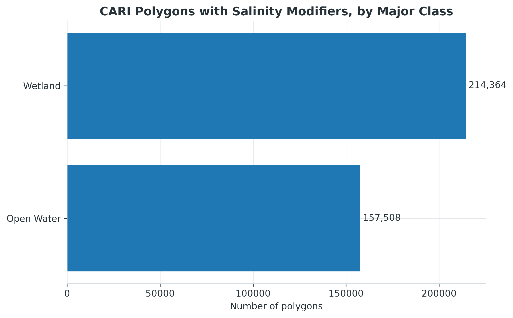
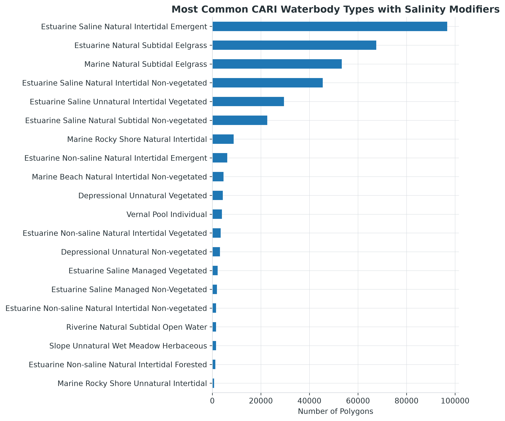
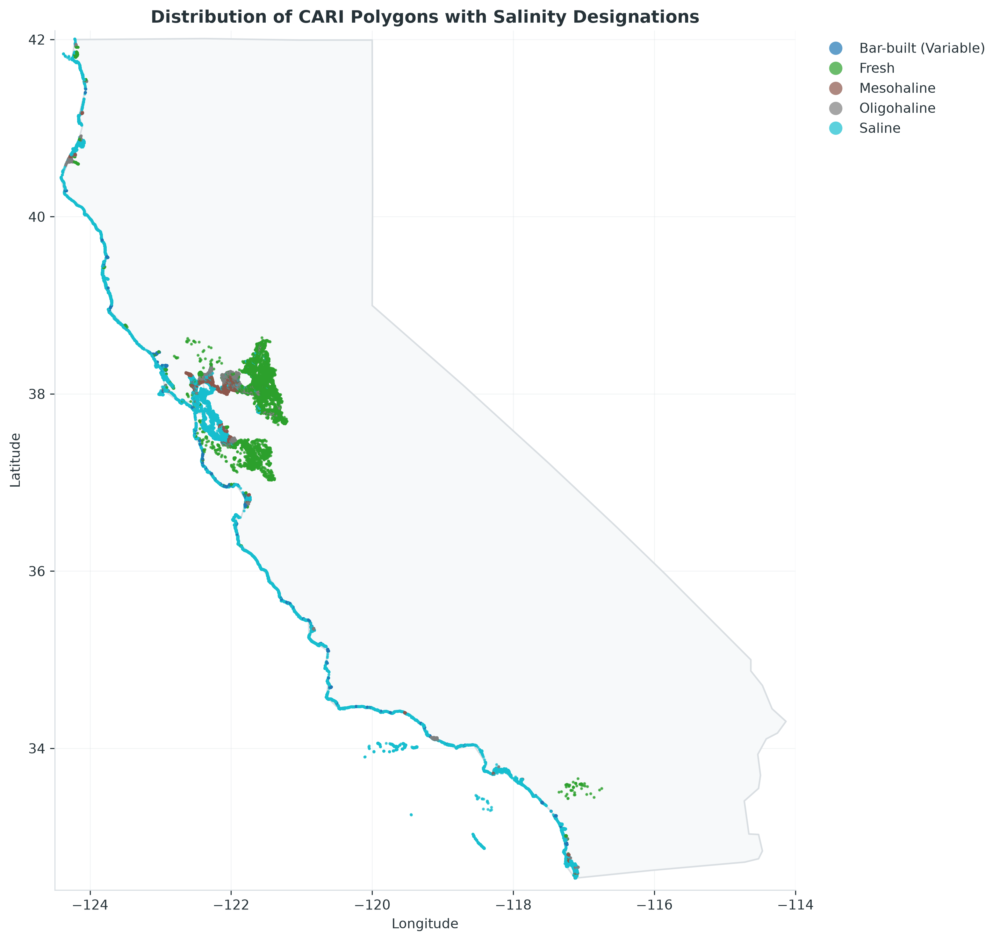
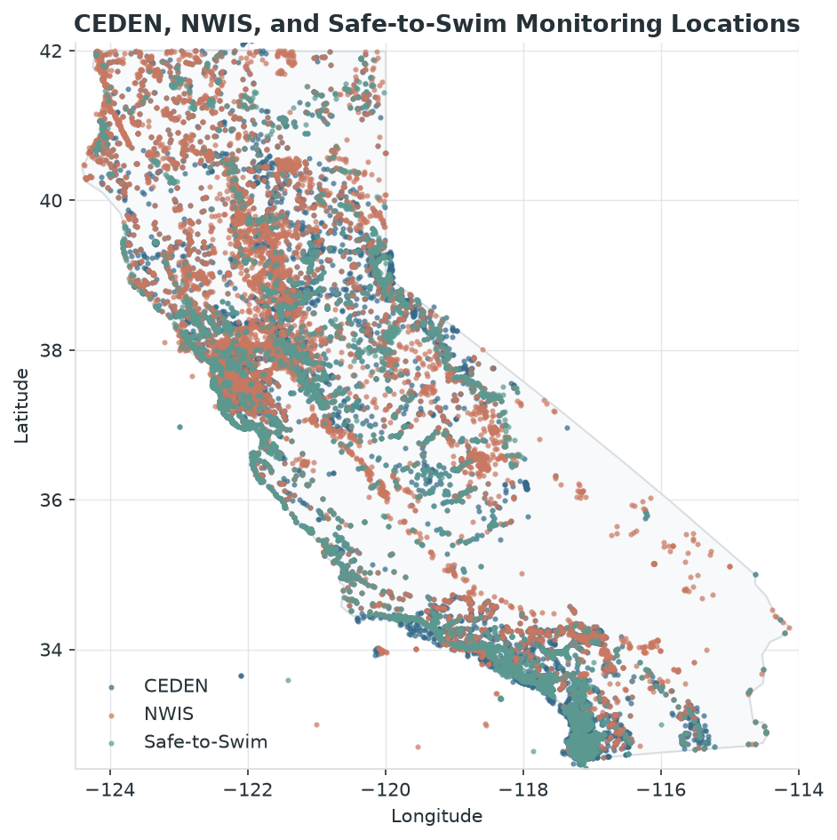
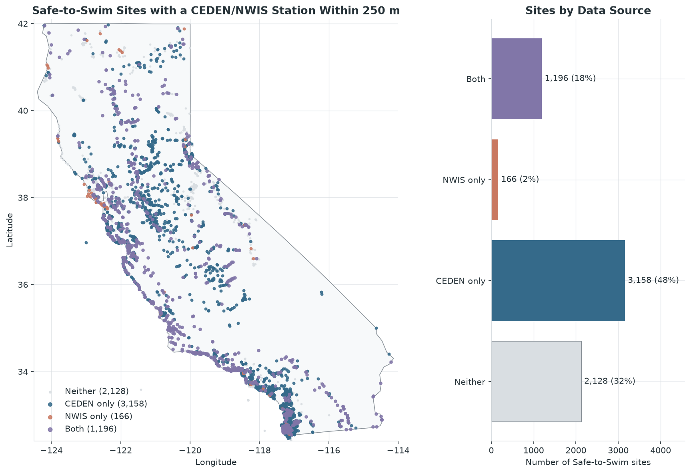
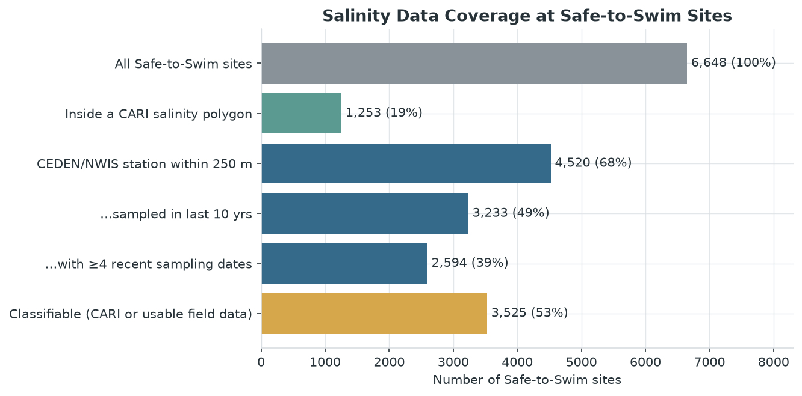
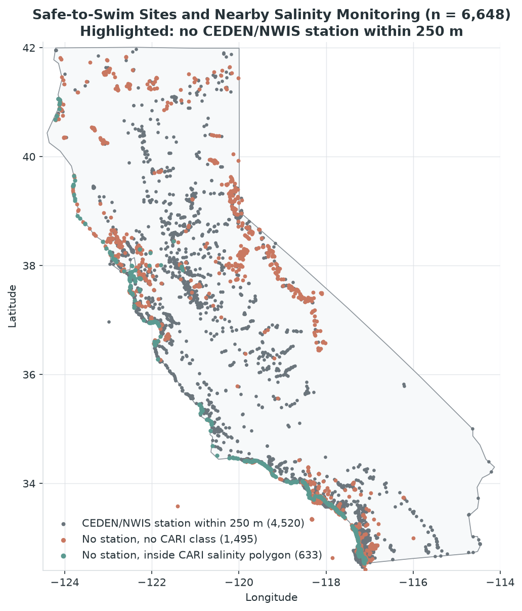

## 1. Introduction & Project Framing

The intention of this project is to assess the status of salinity classification and monitoring coverage across the state of California, with the aim of using this information to develop a database of salinity classifications for major waterbodies. The main use-case for this database is to support the **California Water Boards' Safe-To-Swim (S2S) map** which displays bacterial sampling results for both coastal and inland swimming sites. These sampling results are compared to statewide bacteria water quality standards in order to protect recreational users from the effects of pathogens, and these standards rely on salinity data.

Since 2019, [California’s statewide bacteria objectives](https://www.waterboards.ca.gov/bacterialobjectives/) for water contact recreation have depended on a certain salinity cut-off. Waters at or below 1 ppth salinity for at least 95% of the year are assessed for *E. coli*, and waters above 1 ppth more than 5% of the year are assessed for enterococci. Both indicators are set at the same illness-risk level. Applying the right standard at a Safe-to-Swim site therefore requires knowing not just whether the site is fresh or saline, but how its salinity behaves across a full year – creating a need for consistent salinity monitoring coverage.

Beyond basic water quality, understanding salinity profiles is critical for evaluating broader ecological concerns—such as carbon sequestration dynamics, wetland resilience, and salt-water intrusion with rising sea levels. Sulfate, a very abundant anion in seawater, suppresses methane production, so salty tidal marshes (above about 18 ppt) act as reliable carbon sinks, while fresher marshes emit more methane overall and are much more sensitive to local environmental factors ([Poffenbarger et al. 2011](https://link.springer.com/article/10.1007/s13157-011-0197-0)). This ongoing research involving salinity and carbon sequestration is likely a key reason that the San Francisco Estuary Institute developed **CARI** (California Aquatic Resource Inventory) and further demonstrates the need for salinity models and databases.

Early exploration of datasets and monitoring revealed that the coverage is likely too sparse to immediately develop a state-wide salinity database. Thus this project shifted from building the database do documenting the current state of salinity data, with a thorough exploration of complex waterbody datasets (CARI) and state-wide sampling efforts, in order to inform future monitoring efforts and provide a foundation for a future attempt at the database. **In this analysis, I asses CARI's salinity coverage throughout the state, as well and explore monitoring data coverage at current Safe-to-Swim sites with sampling data from CEDEN and NWIS in order to provide a clear picture of which Safe-to-Swim sites have recent and consistent salinity measurements.**

------------------------------------------------------------------------

## 2. Data Sources & Salinity Coverage in California

This analysis pulls from four data repositories:

- **CARI (California Aquatic Resources Inventory):** Wetland and aquatic feature polygons (`CARI_v3_3_0.gdb`).

- **CEDEN (California Environmental Data Exchange Network):** State-wide ambient water quality monitoring data (`CEDEN_export.tsv`).

- **NWIS (National Water Information System):** Federal physical and chemical water parameters (`resultphyschem.csv`).

- **Safe-to-Swim (S2S):** Current monitoring station locations (`S2S_stations.csv`).

After a preliminary data exploration, it was clear that there is no single standard for salinity monitoring. The two monitoring databases, CEDEN and NWIS, have a vast range of salinity-related measurements – some discrete, some continuous, and with a range of relevant analytes, from chloride to chemical measurements of salinity. There is also no statewide salinity layer that exists for inland waters. CARI, an aquatic inventory developed in 2009 which is based on data from the National Wetland Inventory and the National Hydropgraphy Dataset, focuses its salinity modifiers mainly on coastal and estuary systems.

::: callout-note
### Note on CARI Salinity Classification

CARI’s salinity modifiers were added in 2023, when SFEI received funding to add modeled salinity information to estuarine features for blue carbon quantification. Modifiers are **only applied to estuarine polygons;** anything outside the estuary extent or available vegetation mapping is labeled “N/A.” Each polygon is assigned one of six classes: Fresh (\<0.5 ppt), Oligohaline (0.5–5 ppt), Mesohaline (5–18 ppt), Saline (\>18 ppt), Bar-built (Variable) or Undefined. These classes are meant to reflect dominant salinity conditions, not seasonal or tidal variation. This approach is much more detailed than the cut-off limits for the state water quality standards, and the classes do not align perfectly with existing state limits.

Salinity class modifiers were assigned with a decision-tree framework that drew on two sources. The primary source was vegetation mapping (CDFW VegCAMP and Pacific Veg Map), with each vegetation type crosswalked to the salinity range it tolerates. Where vegetation mapping wasn’t available, salinity measurements were interpolated from the EPA Water Quality Portal (including USGS NWIS and STORET), CEDEN, EMPA, NCCA/NWCA and NERR. The source used for each polygon is recorded in the `Salinity_Source` field.
:::

#### **Other datasets**

For future analyses, another relevant dataset is the **NWI** (National Wetlands Inventory), which describes salinity using Cowardin water chemistry modifiers. These modifiers are optional and likely applied mostly to coastal and estuarine wetlands, giving NWI a coastal bias similar to CARI’s, although I have not verified this. Other efforts, such as California's Integrated Report, may also hold salinity information that is assigned on a site-to-site basis.

::: callout-tip
### Data Extraction Details

- **NWIS** - Queried via REST API for discrete values on 9/3/2026. No limits on dates. Site types: Estuary, Lake, Resevoir, Wetland. Parameter codes: 00480 (Salinity, ppt) 00095 (Specific Conductance), 00940 (Chloride). Original data file shape: (1428878, 81)
- **CEDEN** - Queried from main site on 8/21/2026. Exported as TSV with analytes: ('Salinity, Total', 'Salinity', 'Salinity, Dissolved', 'SpecificConducitivity, Total'. 'SpecificConductivity', 'SpecificConductivity, Not Recorded', 'SpecificConductivity, Dissolved', 'Chloride, Total')
:::

------------------------------------------------------------------------

## 3. Results & Discussion

Overall, CARI’s salinity classification covers only a small portion of Safe-to-Swim sites, while monitoring data appears to cover many more sites (before recency and sampling frequency are considered). Section **3A** summarizes CARI’s salinity coverage and how to interpret it *(Figures 1–3)*. Section **3B** looks at how many Safe-to-Swim sites have nearby CEDEN or NWIS salinity data, and how much of that data is recent and consistent enough to use (*Figures 4–7)*.

### 3A. CARI Investigation

Of the 1,287,921 polygons in CARI, 371,872 (28.9%) have a salinity modifier. Most of these are classified as Saline (66%), followed by Mesohaline (15%), Oligohaline (11%) and Fresh (7%). The most common feature types are tidal marsh, eelgrass and tidal flats (Figure 2), which reflects the modifier’s original purpose of blue carbon quantification.

::: {#fig-cari layout-ncol="2"}
{#fig-cari-class}

{#fig-cari-type}

Despite CARI's statewide coverage, the salinity information is much more localized. The polygons with assigned saline classes are limited to the coast, the San Francisco Bay–Delta and coastal estuaries (Figure 3). As a result, only 1,253 of the 6,648 Safe-to-Swim sites (19%) fall inside a CARI salinity polygon. Before understanding CARI's salinity designation process, the intention was to use CARI's salinity designation as the primary modifier for every waterbody, and verify this designation with monitoring data. Because of this, I cross-referenced my salinity sampling data to classified polygons, and found that only about 0.2% of classified polygons contain a CEDEN or NWIS salinity station from my dataset. This made clear that our initial approach to the database design would be not feasible.
:::

{fig-align="center" width="650"}

Reflecting more on CARI, it is important to note that CARI’s classes do not map directly onto the bacteria standards. The Oligohaline class (0.5–5 ppt) straddles the 1 ppth cutoff, so a site in this class could fall under either the E. coli or the enterococci objective. More fundamentally, CARI assigns one dominant class per polygon, while the bacteria objectives depend on how often salinity exceeds 1 ppth across a full year. Applying CARI’s classes to the bacteria standards would therefore still require measured data.

### 3B. Monitoring Data Coverage at Safe-to-Swim Sites

To assess monitoring coverage, I looked for CEDEN and NWIS salinity stations within 250 m of each Safe-to-Swim site (Figure 4). At a first, the glance coverage looks broad: 4,520 sites (68%) have at least one station nearby (Figure 6). CEDEN provides nearly all of this coverage, and NWIS adds only 166 sites (2%) on its own. Much of the overlap exists because 3,122 Safe-to-Swim sites are themselves CEDEN stations, where specific conductivity is likely recorded during routine sampling. NWIS coverage is likely understated, since my NWIS query did not include stream sites.

### 

{width="600"}

Coverage drops once data quality is considered (Figure 5). Only 3,233 sites (49%) have a nearby station sampled in the last 10 years, and 2,594 (39%) have at least four recent sampling dates. Four dates is a low bar for checking the 95%-of-the-year salinity test, so this should be read as a screening threshold. Combining CARI with usable monitoring data, 3,525 Safe-to-Swim sites (53%) could currently be classified. That leaves 47% without a defensible salinity class.

The 2,128 sites with no nearby station are concentrated in the Sierra Nevada, the northeast and the desert regions (Figure 7). These are mostly inland lakes and rivers outside CARI’s estuarine focus. Many of these sites are likely to be fresh, but there are known saline lakes in the same desert and eastern regions – such as the Salton Sea and Mono lake. A full list of these sites, with each one’s nearest station and distance, is saved in `s2s_sites_no_salinity_station_250m.csv` for future reference.

{fig-align="center" width="750"}

The monitoring data itself is also inconsistent. CEDEN records mix specific conductivity (\~690,000 records), salinity (\~478,000) and chloride (\~33,000), and about 60,000 conductivity records have the fraction listed as “Not Recorded.” Some coordinate locations also have more than one station code. Before this data can support a salinity database, these parameters would need to be converted to a common salinity measure.

## 4. Future Work & Intentions

- **Shared Contributable Database:** Transitioning toward a collaborative, open-access database architecture where regional agencies and researchers can contribute updates.
- **Expanded Monitoring Integration:** Expanding automated ingestion pipelines to capture ongoing conductivity and total dissolved solids (TDS) metrics across state watersheds.

------------------------------------------------------------------------

## 5. Analysis Procedure

### Packages & Tools

- **`geopandas` & `pyogrio`:** Vector spatial data ingestion (`.gdb` layers), CRS management, and spatial joins/intersections.
- **`pandas` & `numpy`:** Tabular data cleaning, filtering placeholder values, and summary aggregations.
- **`matplotlib` & `seaborn`:** Generating static summary charts and spatial maps exported to `docs/figures/`.

### Major Processing Steps

1.  **Data Ingestion & CRS Verification:** Loaded tabular exports (CEDEN, NWIS, S2S) and read the `CARI_Polygons` layer directly from the File Geodatabase.
2.  **Attribute Filtering:** Removed null and placeholder salinity entries (`"Undefined"`, `"N/A"`, `"n/a"`) to isolate verified salinity-modified polygons.
3.  **Spatial Joins & Overlap Checks:** Cross-referenced point monitoring stations (CEDEN, NWIS, S2S) against CARI polygon boundaries to assess coverage gaps and dropped features.